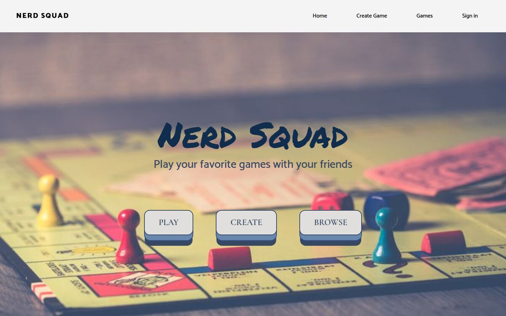
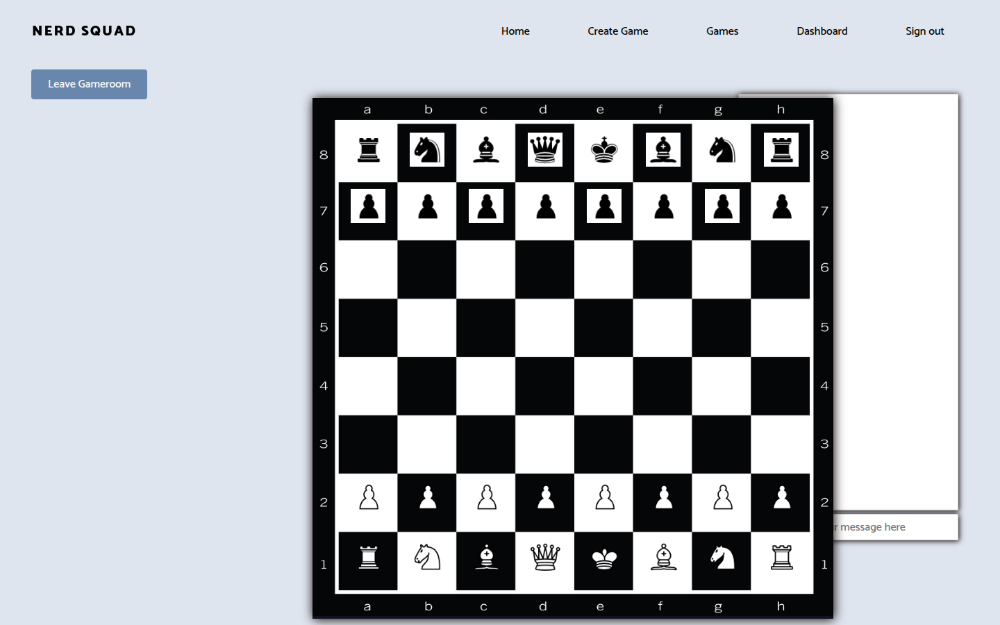

# Nerd Squad: stay safe & roll initiative

[](https://github.com/mat2m10/nerdsquad/actions/workflows/ci.yml)

Build your own board game in the browser, then play it live with friends.

Nerd Squad is a Rails app made by a five-person team during the
[Le Wagon](https://www.lewagon.com) coding bootcamp (November 2020). Raphael Marsan
kept working on it until December 2021. You design a game from its parts: a board,
dice, card decks, pieces and tokens. Then you open a game room where everyone
moves the same pieces in real time and chats while they play. Monopoly and chess
come ready-made in the seed data.

> **Status:** feature work stopped in December 2021. In 2026 the app was upgraded to
> Ruby 3.3 and Rails 8.1, with tests, CI and access control added. No new features.

## Screenshots





## Features

- **Game builder:** create a game, then add a board, dice, card decks with cards,
  pieces and tokens. Boards, dice, cards, pieces and tokens each have their own
  uploaded image. You can preview a game
  before playing it.
- **Clones:** playing a game makes a copy of it (a "clone" of every part), so a
  match never changes the original game.
- **Live game rooms:** drag pieces, cards and tokens on the board (mouse or touch).
  Every move is broadcast to everyone in the room through Action Cable.
- **Chat** inside each game room.
- **Search** games by name (Postgres full-text search via `pg_search`).
- **Accounts** with Devise. Everything except the home page and the account pages
  (sign in, sign up, password reset) requires login. Only a game's owner can change it. Only players
  who joined a room can move its pieces, chat, or receive its live updates.

## Stack

| | |
|---|---|
| Backend | Ruby 3.3, Rails 8.1, PostgreSQL, Devise, Action Cable (Redis in production) |
| Frontend | importmap (no Node build), Bootstrap 4, jQuery, Turbolinks, plain JavaScript for drag and drop |
| Images | Active Storage: Cloudinary in production, local disk in development unless `CLOUDINARY_URL` is set |
| Tests | Minitest (models, controllers, channels) and Brakeman, run on GitHub Actions |

## Running it locally

You need Ruby 3.3.12 (see `.ruby-version`), Bundler and PostgreSQL. Node is not
needed. Uploads are stored on local disk unless you set `CLOUDINARY_URL` in `.env`.

```bash
git clone https://github.com/mat2m10/nerdsquad.git
cd nerdsquad
bundle install
bin/rails db:create db:schema:load db:seed   # seeds attach the Monopoly and chess images
bin/rails server
bin/rails test                               # run the test suite
```

Then open http://localhost:3000. The seeds create two test accounts,
`b@t.man` and `r@b.in`, both with password `123456`. Use them only locally.

In production, Action Cable needs Redis through `REDISCLOUD_URL`, uploads go to
Cloudinary through `CLOUDINARY_URL`, and the database comes from `DATABASE_URL`.

## Team

| | GitHub | Role |
|---|---|---|
| Raphael Marsan | [@margerabe](https://github.com/margerabe) | Main developer: most of the commits, November 2020 to December 2021 |
| Matthieu de Hemptinne | [@mat2m10](https://github.com/mat2m10) | Early contributor, November–December 2020 |
| Pierre Lion | [@JavaProScript](https://github.com/JavaProScript) | Contributor, November–December 2020 |
| Aurelie Rousseau | [@Aurrou](https://github.com/Aurrou) | Contributor, November 2020 |
| Nicolas Eloy | [@Nicoeloy](https://github.com/Nicoeloy) | Contributor, November 2020 |

Generated from the [Le Wagon Rails templates](https://github.com/lewagon/rails-templates).
